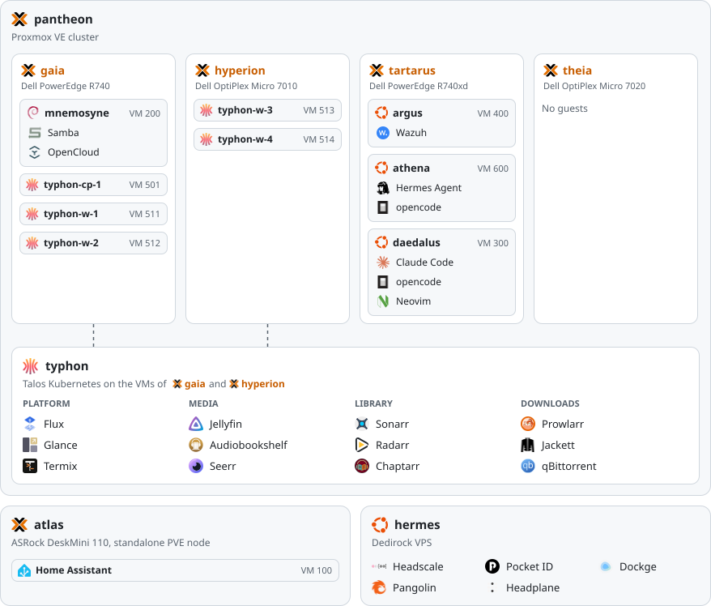

# homelab-iac
## this is my homelab infrastrucure defined as code

| Hypervisor                                                                                      | OS                                                                                                                                                                                                                                                                                                                                                                                             | Tools                                                                                                                                                                                                                                                                                                                                                                                                                                                                                                                                                                                                                                                                                                                         | Networking                                                                                              | Misc. Automations                                                                                                                                                                                      |
| ----------------------------------------------------------------------------------------------- | ---------------------------------------------------------------------------------------------------------------------------------------------------------------------------------------------------------------------------------------------------------------------------------------------------------------------------------------------------------------------------------------------- | ----------------------------------------------------------------------------------------------------------------------------------------------------------------------------------------------------------------------------------------------------------------------------------------------------------------------------------------------------------------------------------------------------------------------------------------------------------------------------------------------------------------------------------------------------------------------------------------------------------------------------------------------------------------------------------------------------------------------------- | ------------------------------------------------------------------------------------------------------- | ------------------------------------------------------------------------------------------------------------------------------------------------------------------------------------------------------ |
|  |   |       [![mise](https://img.shields.io/badge/-mise-black?logo=data%3Aimage%2Fpng%3Bbase64%2CiVBORw0KGgoAAAANSUhEUgAAAB8AAAAgCAYAAADqgqNBAAAABmJLR0QA%2FwD%2FAP%2BgvaeTAAADPklEQVRIidXXW4zdUxQG8N9MMRmmSjO0qDbESHVoBU0pU0ZcmhIleEH0QfSBkBIPEpeEoJMGaUJ4E1KlGtWWpJNW3MWlJiVu04q0GPcgSJSkEh6%2Bc%2Br0zLn4z8wD39PJf6%2B9197r8q3v8D9AJ%2B7Gm3gP63AxWipszsEqDOJjrMS80TruwRe4Bd2YioV4A2sxHk%2FgldKFujADV%2BFDPIDWkTg%2BBF9jTo21VjyK7%2FCgPaNQRhvWYOlInN%2BLZQ3W5%2BAvnNnApgOf44iizt%2FH8Q3Wl%2BJxSUEjLMON1R%2Bb5WIyPmmw%2Fhsm4aAm52xV4%2BV7Ndn0o%2BRtZ531%2B%2FAzXm9yzgT80sTGRNyBdzCEXXgN16O92eYG2Ij51R8rw3665O4naaXDcVvpxl3oL%2Bhwb%2ByLc6VrNtUzPBhfGl5cU6TVrsa3BZ1fIOkYwqxGhreq34s9eBi9BZ23yYVPaWa48d8YjQB34tp6i%2BWcd0iuxxIzMQ3XqM1%2Bu51%2FiqPHwGELFuBV3I8X8CuekaG0BqdVb1qADaN0vBADeAon4nKZbutwqXTMfOzAkdU3Xo8%2BjCvotBsv4mkcg8vwAR6TaM4s2ZSxHFdWH9IuU2pQCmWxEM4W4YBqjMPNMjZ7pZ22SGi7KuyGZLDAARKNY%2Bu9ZLowWh%2BWYBE227NoOvE8HhLqvL302rNrnNeP30uX%2BgrX1XNcD8%2FikorLDeIKCfOACIZ2yeWBFfumykuX4Ayh78LoxkfCgFtxcun7hUKfZSzGD3gOL%2BMbNfI7EjwiqqUH%2BzWwGy%2FabS4uEu131Gidn4c%2FZAZ8JtxdjQkVv2fJdCzXz4gxTSp22FgsoVOIZQdWlL5NlpqoxEtS8YVwD27AXTLlqqdUnwynSpwgqrfMGy34XgZOIawUXX5o6cAOkdJlVdtr%2BIuWY5t0QRtm462ijklvrhBRcJbQ5S4JbRnniwApY57ots1CvatEF%2BxGzWlTA%2FuUnHfJ9JuIt6XqF2F%2FbBdNt1ZCfSpuEtbcJpGajT%2BLOi9juoT8XdHrq4W9npR%2B78BxMi0HRITMkHbr9Q%2FNjglahVq3i947SRhuivR4v%2FyNOqzW5qIvr4dJks%2B5Msl2So%2BvFpX038PfRsilZPeeBYkAAAAASUVORK5CYII%3D)](https://mise.jdx.dev/)  |  |  |

<picture>
  <source media="(prefers-color-scheme: dark)" srcset=".github/assets/services-dark.svg">
  
</picture>

## Quick Overview
So this is all of my IaC stuff for my homelab.

I have a total of five physical machines in the homelab itself, plus my personal devices. The exact machines and what they run will be further down.

Everything here uses IaC and I prefer not to use [Docker](https://www.docker.com/) wherever I can use [Kubernetes](https://kubernetes.io/) instead, but kubernetes is a fickle beast that doesn't behave well sometimes. I'm forced to use Docker on things like my VPS and some other places where kubernetes doesn't make a lot of sense. With that, all of my kubernetes nodes are virtualized inside of [Proxmox](https://www.proxmox.com/). You might think "but Caleb why would you have kubernetes and Proxmox at the same time, wouldn't that lead to fights with HA?" and you'd be right. I have HA disabled on the kubernetes nodes to reduce the chance that I'd run into issues with kubernetes nodes migrating to other proxmox nodes etc. Even with that my storage lives on a single proxmox node so it's my single point of failure regardless unless I want to setup something like [Ceph](https://ceph.io/)... which I don't want to do.

To automate infrastructure updates and deployments I am using [GitHub Actions](https://github.com/features/actions) which trigger based on specific changes in this repository. You can look at the actions runs to see that there are some things called `pantheon`, `atlas`, `hermes` and so on; we'll get into that later.

## Security
For security I've been lazy and honestly try to make things as easy as possible for myself in regards to this. Some of the tools I use are as follows:

- [GitGuardian](https://www.gitguardian.com/) for if I leak a secret on accident.
- [Wazuh](https://wazuh.com/) for SIEM / Alerting
- [SOPS](https://getsops.io/) for encrypting secrets so I can just be lazy and commit them here instead of running a seperate secret manager like [Bitwarden](https://bitwarden.com/) or [OpenBao](https://openbao.org/).

VPS's specifically get special treatment since I use those for network ingress through [WireGuard](https://www.wireguard.com/) tunnels into my network. I use [Pangolin](https://pangolin.net/) for this as it acts as a reverse proxy as well as allows me to create "[Cloudflare Tunnel](https://developers.cloudflare.com/cloudflare-one/networks/connectors/cloudflare-tunnel/)" esque endpoints for services I don't want to fool around with. On these VPS's they're hardened with [CrowdSec](https://www.crowdsec.net/), [Fail2Ban](https://github.com/fail2ban/fail2ban), as well as having all password login disabled in favor of SSH keys. I also prefer not to leave my personal SSH key on the VPS's and instead us [opkssh](https://github.com/openpubkey/opkssh) to handle logins throughout my network.

## Monitoring / Observability
Nothin' right now. Working on that.

## Cloud Dependencies
Although I try to self-host everything I can, my infra still relies on the cloud for certain services.

| Service                                                                                 | Use                                                                                                             | Cost           |
| --------------------------------------------------------------------------------------- | --------------------------------------------------------------------------------------------------------------- | -------------- |
| [Proton](https://proton.me/)                                                            | VPN                                                                                                             | ~$85/yr        |
| [GitHub](https://github.com/)                                                           | Hosting this repo and continuous integration/deployments                                                        | Free           |
| [Cloudflare](https://www.cloudflare.com/)                                               | Domains and DNS                                                                                                 | Free           |
| [Dedirock](https://dedirock.com/)                                                       | Primary VPS, `hermes`                                                                                           | $48/yr         |
|                  |                                                                                                                 | Total: ~$11/mo |

## Hardware
yeah so this is the section you're going to be like "why?!?"

  
<strong>Servers</strong>

| Name         | Device                   | CPU                       | RAM       | Storage           | GPU        | Purpose                                    |
| ------------ | ------------------------ | ------------------------- | --------- | ----------------- | ---------- | ------------------------------------------ |
| **atlas**    | ASRock DeskMini 110      | Intel i5-7600             | 16GB DDR4 | 1TB HDD           | Integrated | Proxmox node (standalone), Home Assistant  |
| **gaia**     | Dell PowerEdge R740      | 2x Intel Xeon Silver 4110 | 64GB DDR4 | 7x 1.2TB HDD      | n/a        | Proxmox node (`pantheon`), NFS storage     |
| **hermes**   | Dedirock VPS             | 2 vCPU (Intel i9-14900K)  | 4GB       | 64GB NVMe         | n/a        | Public VPS, Pangolin, Headscale, Pocket ID |
| **hyperion** | Dell OptiPlex Micro 7010 | Intel i5-13500T           | 16GB DDR4 | 512GB NVMe        | Integrated | Proxmox node (`pantheon`)                  |
| **tartarus** | Dell PowerEdge R740xd    | Intel Xeon Silver 4210    | 32GB DDR4 | 2x 1.92TB SAS SSD | n/a        | Proxmox node (`pantheon`)                  |
| **theia**    | Dell OptiPlex Micro 7020 | Intel i7-14700T           | 16GB DDR5 | 512GB NVMe        | Integrated | Proxmox node (`pantheon`)                  |

  
<strong>Networking</strong>

| Name   | Device                  | Purpose         |
| ------ | ----------------------- | --------------- |
| Router | UniFi Dream Machine Pro | Router/Firewall |
| Switch | HP Aruba 2530-24G       | Switch          |

  
<strong>Personal</strong>

| Name           | Device      | CPU               | RAM          | Storage   | GPU             | Purpose    |
| -------------- | ----------- | ----------------- | ------------ | --------- | --------------- | ---------- |
| **hephaestus** | Custom      | AMD Ryzen 7 7700X | 32GB DDR5    | 1TB NVMe  | Nvidia RTX 3080 | Primary PC |
|                | MacBook Pro | Apple M1 Max      | 32GB Unified | 512GB SSD | Integrated      | Laptop     |

